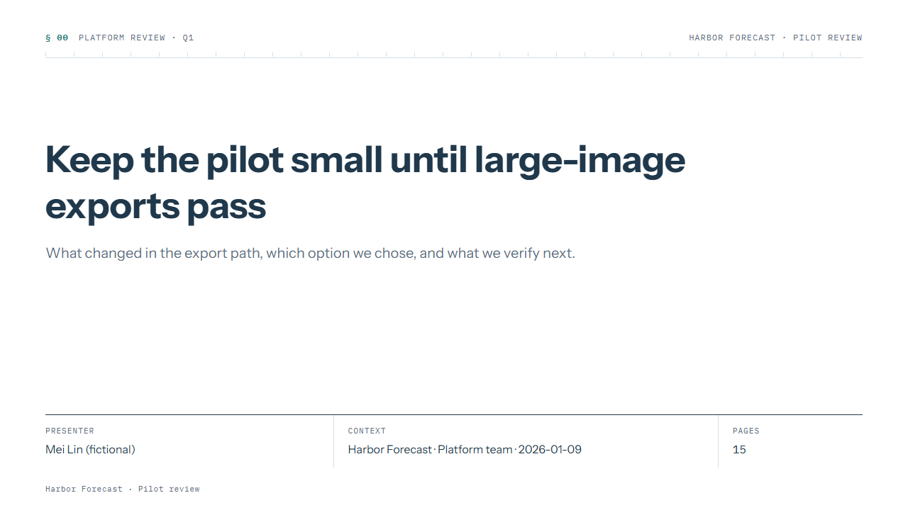
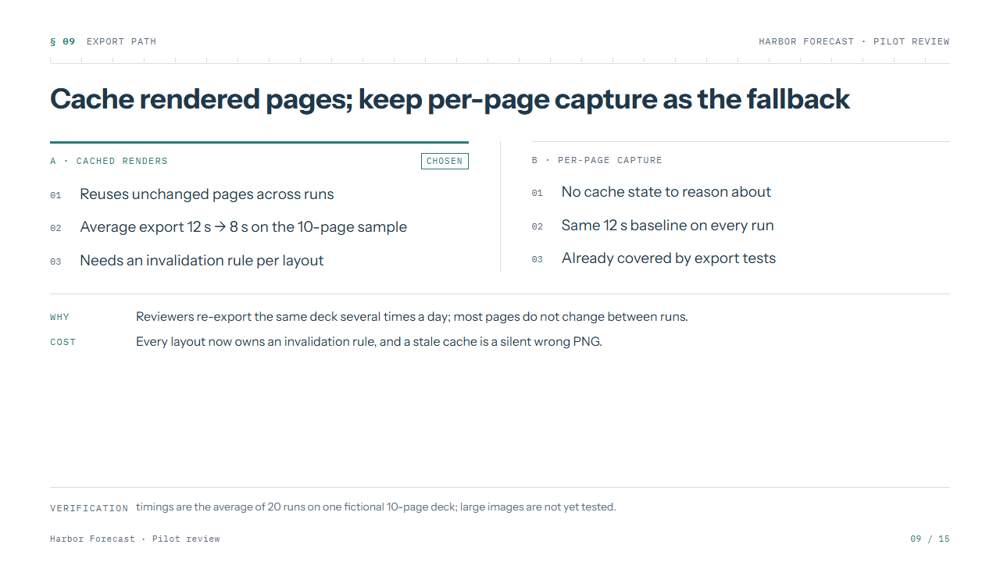
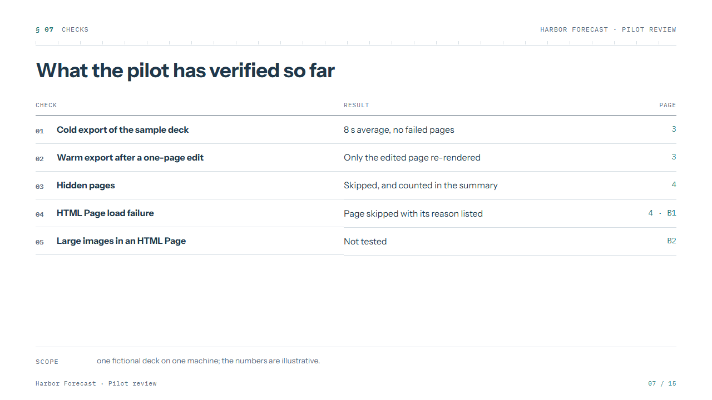
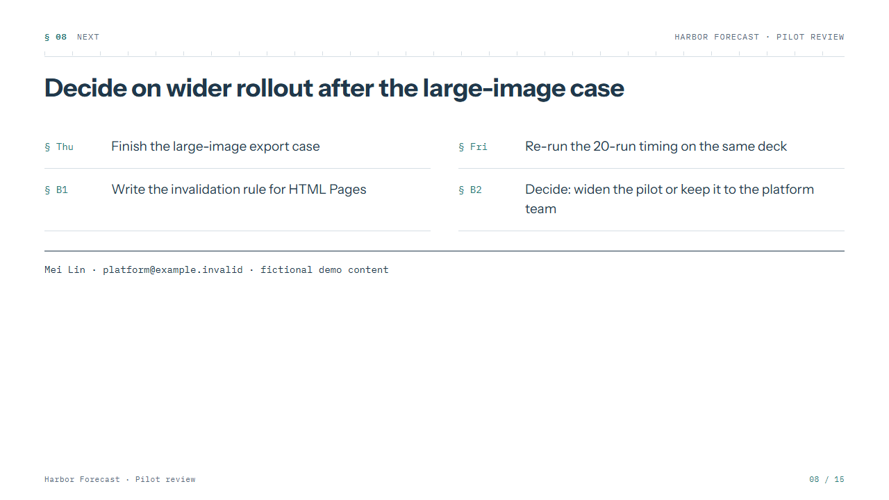
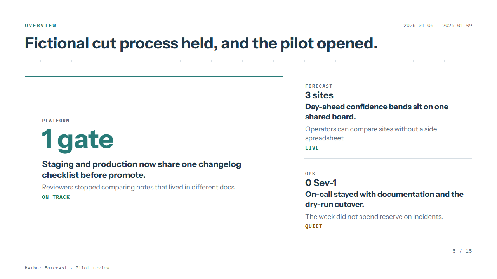
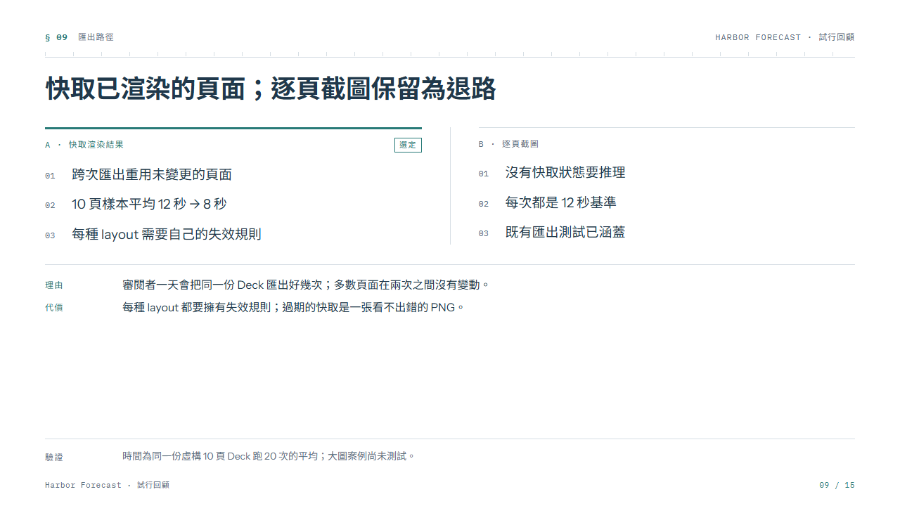
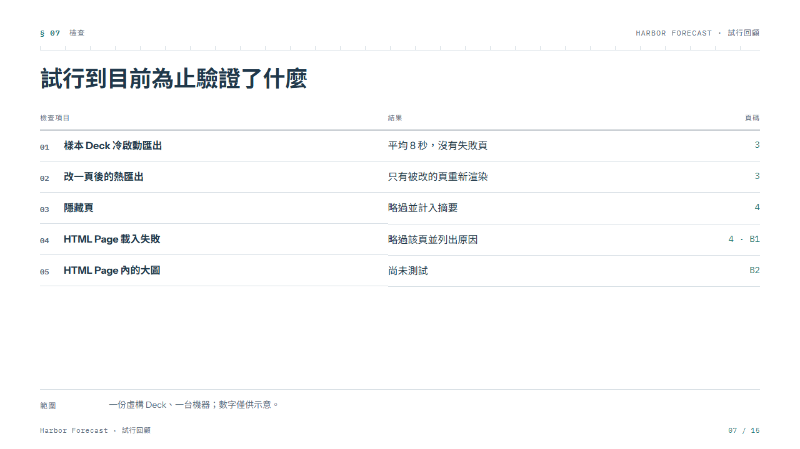

# Stage 主題原型：Editorial Observatory 的三種表現

建立日期：2026-11-07

最後更新：2026-11-07

---

2026-11-07 以拋棄式入口（`/prototype.html`、`src/prototype/`）檢驗 [Stage 設計哲學](stage-design-philosophy.md) 落到 16:9 Stage 時該長什麼樣。問題只有一個：**新 Deck Theme 與四個新 Structured Layout 應採用哪一種結構表現？** 三個變體在同一組文案、同一組 token 色票下做結構上不同的回答，另加一頁既有 Overview 驗證「既有 layout 只接主題 token」是否成立。

原型不接 Deck JSON、Workshop editor 或 Export gate；量測、截圖與字型嵌入檢查都在原型內完成。

## 變體

| 變體             | 結構回答                                                                                                              | 字型                                       |
| ---------------- | --------------------------------------------------------------------------------------------------------------------- | ------------------------------------------ |
| A「Rule」        | 最接近作者手刻的 HTML Page：左側 accent bar、無分隔線、圓角卡片、Deck Title 加強調色頁碼                              | 系統 Noto Sans TC                          |
| B「Observatory」 | 等寬字索引 `§ 09`、標頭下方刻度線、要點與表格列編號、chosen 欄以上緣粗線加 tag 標示、Tradeoff 以 WHY／COST 定義列呈現 | Instrument Sans、IBM Plex Mono（自架 OFL） |
| C「Block」       | 強調色當材質：Cover 左側實色帶、chosen 欄整塊實色、表頭實色、頁碼方塊                                                 | Bricolage Grotesque（自架 OFL）            |

五頁：Cover、Side-by-side Comparison、Full-width Panel（table）、Closing，加既有 Overview；每頁有英文與中文文案。

## 驗證結果（2026-11-07）

| 檢查                             | 結果                                                                                                                                      |
| -------------------------------- | ----------------------------------------------------------------------------------------------------------------------------------------- |
| 1280 × 720 內無溢出              | 通過。三變體 × 五頁 × 兩語言共 30 頁，`scrollWidth`／`scrollHeight` 皆為 1280 × 720。                                                     |
| `html-to-image` 嵌入自架字型     | 通過。以 `toSvg` 檢查：B 嵌入 4 個 `@font-face`（Instrument Sans、IBM Plex Mono 各兩字重），C 嵌入 2 個，A 為 0；只嵌入該頁有用到的字型。 |
| 既有 Overview 只接 token         | 通過。三個變體都只靠覆寫 `--blue*` 等 token 與少量外框 CSS，`OverviewSlide` 元件未改。                                                    |
| 中英混排                         | 通過。拉丁展示字型粗體與 Noto Sans TC 粗體並排時字重接近；B 的等寬記號在中文頁仍可辨認。                                                  |
| 每頁一個主焦點、最多一個實色區塊 | 通過。C 的 Closing 聯絡區塊與 Cover 實色帶不會同頁出現。                                                                                  |

截圖以 Windows 端 Chrome headless 取得，CJK 字型為系統 Noto Sans TC。

## 決定：採用 B「Observatory」

理由：

- 它是三者中唯一把哲學文件的「觀測紀錄」氣質（索引、刻度、編號）做成結構的一個；A 只是把手刻頁正規化，C 的實色區塊與「最多一個實色填滿區塊」的約束最緊張。
- 等寬記號讓參照編號（頁碼、要點序號、`§` 索引）有固定位置，回答了哲學文件留給原型的第二個字型問題。
- 既有 Overview 套 B 後，lead 區塊由色塊改為細框加上緣粗線，與新 layout 的 chosen 標示是同一種語言。

原型階段看到並已決定處理方式的問題：

| 問題                                                     | 處理                                                                                        |
| -------------------------------------------------------- | ------------------------------------------------------------------------------------------- |
| Closing、Comparison 內容少時貼底的 closing line 留白過大 | Closing 的 closing line 緊接 takeaways，不貼底；Boundary Note 仍貼在頁尾之上。              |
| Overview 的 Deck Title 以覆蓋層示意                      | 正式實作把 Deck Title 與頁碼放進 Editorial Frame 的 footer。                                |
| `§ B1–B2` 之類的附錄參照                                 | takeaway 的 ref 是作者自由文字；附錄頁標號（B1）本輪延後，`§ nn` 索引只來自 Page Position。 |
| `prettier-plugin-tailwindcss` 修掉 `className` 前導空白  | 正式實作組 class 名一律用 `cn()` 或整串條件式，不用 template literal 拼接。                 |

規格見 [Deck Theme and the Observatory layouts](../specs/deck-theme-and-observatory-layouts.md)，決策見 [ADR-0002](../adr/0002-deck-theme.md)。

## 截圖（虛構文案）

| Cover                                               | Side-by-side Comparison                                    |
| --------------------------------------------------- | ---------------------------------------------------------- |
|  |  |

| Full-width Panel（table）                           | Closing                                                 |
| --------------------------------------------------- | ------------------------------------------------------- |
|  |  |

| 既有 Overview 套 B                                        | 中文：Comparison                                              |
| --------------------------------------------------------- | ------------------------------------------------------------- |
|  |  |

## 封存

原型程式碼（含 A、C 兩個落選變體與切換列）是本決定的一手來源，依約定放在拋棄分支 `prototype/stage-theme-variants`，不進 `dev`；`dev` 只保留本文件、規格與 ADR。原型的拋棄式入口在規格第四個 slice 完成後移除。

## 相關文件

- [Stage 設計哲學](stage-design-philosophy.md)
- [好的 Slide：新 Structured Layout 的研究參考](slide-design-research.md)
- [Layout 家族原型](layout-prototype.md)：前一次拋棄式原型的做法與驗證指標
